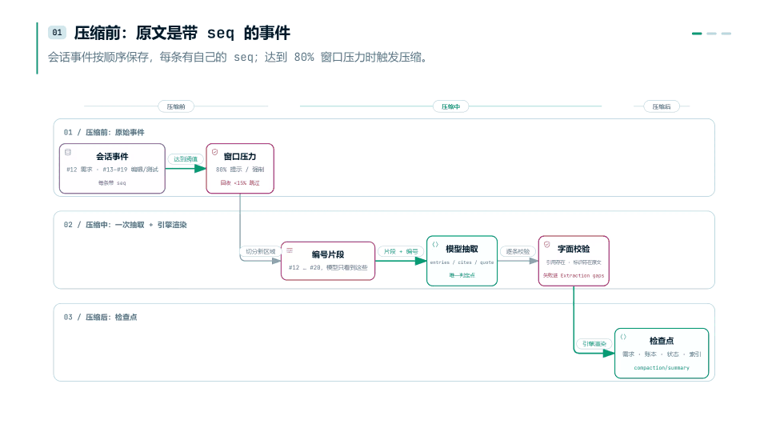

# dsh-wsc

**给 DeepSeek Harness 的长会话压缩保留工作状态和可回查的证据。**

WSC（Work State Compaction）是 DeepSeek Harness 的社区压缩后端，包名 `@xeyo/dsh-wsc`。它在 `cordis` preset 中接替原生的 `compaction-basic`，将用户要求、工作状态和证据索引整理成结构化检查点。续跑时可以用会话事件序号 `#seq` 回查当时改了什么、跑了什么。

当前默认策略为 **v3r**。它把检查点里的编辑和检查回执绑定到会话事件序号，方便跨多次压缩回查。

[安装与试用](#安装与试用) · [检查点格式](docs/checkpoint-format.md) · [完整实验报告](experiments/过往实验/2026-11-24-final-benchmark/README.md)



## 与 DSH 原生压缩的对照

在 `long-40` 场景中，Agent 要连续 40 轮改造同一个 CLI。WSC v3r 和 DSH 原生压缩各跑 8 次。按实验设定的 token 单价折算，并计入压缩相关模型调用，**v3r 的单次运行成本中位数低约 47%**。

| 指标 | WSC v3r | DSH 原生压缩 |
| --- | ---: | ---: |
| 估算成本中位数 | **¥0.720** | ¥1.356 |
| 压缩次数中位数 | **16** | 35 |
| 耗时中位数 | **2,117 秒** | 2,718 秒 |
| 末轮严格问答 | 40/48 | 40/48 |

v3r 的 8 次运行中，最终工作区均通过全部 54 项检查。报告还包含 `constraint-25` 场景、其他策略的结果和成本修正口径。 [最终对照与逐次记录](experiments/过往实验/2026-11-24-final-benchmark/) · [评测场景与运行说明](experiments/README.md)

## 安装与试用

在已有 DeepSeek Harness 的环境中，把本包链接到目标 profile 的 `node_modules/@xeyo/dsh-wsc`。Windows 可用目录联接（junction）。把以下配置应用到该 profile 实际使用的 `cordis` preset 接线，启用 WSC 并停用原生压缩后端。 [最小接线](profiles/default.cordis.patch.yml) · [Desktop 配置示例](profiles/README.md)

```yaml
- id: wsc-config
  name: "@xeyo/dsh-wsc"
  config:
    mode: active

- id: compaction-basic
  disabled: true

- insert:
    - id: wsc-engine
      name: "@xeyo/dsh-wsc/engine"
```

- **确认生效**。在测试 profile 里触发一次压缩，查找日志中的 `wsc nosig checkpoint` 或会话 `compaction/summary` 中的 WSC 检查点。可以让模型在已有足够历史的会话中调用 `compact_context` 请求压缩，执行发生在后续模型请求边界，也受回收量门槛约束。
- **回切原生**。移除这份 WSC 接线，恢复该 preset 原先的 `compaction-basic` 配置，再重新加载 profile。
- **抽取用量**。`nosig` 使用当前会话的 DSH provider 和模型，抽取会产生模型请求。抽取用量和账本位于 `$DSH_HOME/wsc/nosig/<session>.jsonl`。

## 检查点是什么样

例如，用户要求把税率改为 `0.07`、报表上限改为 `500`，并保留 API 字段名。续跑时遇到一句「测试通过」，Agent 可以用检查点里的事件序号确认这次检查发生在什么时候。当用户要求判断某个文件版本是否被覆盖时，检查范围以原始命令和结果为准。

```text
User requirements (verbatim, in order):
1. "把 TAX_RATE 改成 0.07，报表上限改成 500，别改 API 字段名"

Ledger (current):
- Constraint: 不改 API 字段名.
- Decision: 报表上限改成 500.
- Context: src/tax.py: TAX_RATE = 0.07.

Checks: src/report.py was edited at #18; the check at #19 (pytest) reported: 4 passed.
Evidence index (fetch by key): [E2] edit src/report.py (read_evidence #18).
```

`read_history` 可以按 `seq` 查看历史消息，`read_evidence` 可以读取已归档的证据。上面是简化示例。实际检查点还可能包含最新请求、当前工作状态、最近修改和工具观测值。 [区块与回查约定](docs/checkpoint-format.md)

## 压缩如何工作

1. **选取历史。** 引擎根据窗口压力选出压缩范围，保留工具调用和结果的配对边界。默认有效窗口上限为 `256000` tokens，并受模型可用窗口约束。`warnRatio` 与 `forceRatio` 均为 `0.8`。模型请求的压缩以预计回收量判断是否执行，默认下限为有效预算的 `15%`，强制压力线可直接准入。
2. **抽取账本。** `nosig` 给新区域的消息编号，让模型结合已有账本提出新增或修订。通常一轮抽取，区域过大时分段，单次抽取失败时可以重试。引擎校验引用和部分字面锚点，记录抽取缺口。账本内容仍可能包含模型判断。
3. **渲染并回查。** `lib/passage.js` 按固定结构组装用户要求、账本、状态和证据索引。默认保留用户请求正文，并按出现顺序展示去重后的请求；账本在渲染时折叠部分旧值，保留 journal。空间不足时优先缩减证据索引、观测值和账本。状态区明确标为 `unverified`。

工具输出去噪可在压缩前缩短重复读取和部分命令日志。原始文本成功保存到 spill store 后才替换视图，压缩完成后重置读去重状态。 [运行时去噪](docs/denoise.md) · [设计取舍](docs/design-notes.md)

## 开发与验证

```bash
npm test
```

- [`index.js`](index.js)、[`engine.js`](engine.js)、[`client.js`](client.js) 对应配置、压缩后端和设置页。
- [`lib/`](lib/) 包含账本抽取、状态投影、去噪和证据索引。
- [`profiles/`](profiles/) 提供 profile 接线示例。
- [`tests/`](tests/) 是单元测试与离线契约测试。
- [`experiments/`](experiments/) 包含评测脚本、场景和[历次实验记录](experiments/过往实验/)。

许可证为 [MIT](LICENSE)。
