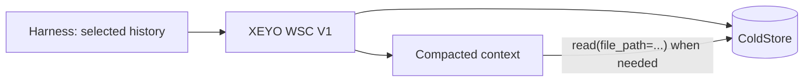

# XEYO WSC for DeepSeek Harness

[中文](#中文说明)

XEYO WSC is a deterministic, model-free context compaction backend for DeepSeek Harness.

This repository integrates the XEYO WSC V1 and V2 implementations with DeepSeek Harness `0.1.1-rc.2`. WSC handles the context projection itself, while the Harness continues to manage the compaction transaction, token accounting, checkpoints, surface replacement, and tool-call pairing checks.

WSC does **not** call an LLM during compaction.

## Why WSC

Long sessions mix active task state with details that are costly to keep in the hot context. WSC deterministically keeps a compact working view; V1 can retrieve selected offloaded details from ColdStore without an LLM call.

## What this repository contains

The repository includes:

- a DeepSeek Harness compaction plugin;
- the XEYO WSC V1 and V2 cores;
- persistence and protocol glue required by DSH;
- an `xeyo-wsc` agent preset based on the `standard` preset shipped with DSH `0.1.1-rc.2`.

In this version of DeepSeek Harness, the compaction backend is configured through an **agent preset**, rather than the host profile.

The included `preset/` directory is a copy of the shipped `standard` preset with only the `compaction-basic` backend replaced by XEYO WSC.

Do not modify the Harness's built-in preset directly.

## Implementations

### V1

V1 uses XEYO's production WSC projection.

It includes:

- deterministic context selection;
- closure and economic filtering;
- the `Medium+` projection profile;
- persistent `AssemblyState`;
- persistent `ColdStore`;
- recoverable `Read` references for offloaded context.

Cold views are stored under:

```text
.xeyo_offload/dsh-wsc/
```

inside the session workspace.

WSC state is committed only after DeepSeek Harness confirms that the compaction transaction completed successfully.

### V2

V2 rebuilds XEYO's deterministic V2 reducer from the source events contained in the Harness-selected compaction span, then renders the canonical V2 state.

V1 and V2 are separate WSC projections and are intentionally not expected to produce identical output.

### Model usage

Neither V1 nor V2 invokes an LLM during compaction.

From the Harness's point of view, WSC produces a deterministic summary. DeepSeek Harness remains responsible for the surrounding compaction transaction and checkpoint lifecycle.

## Example: before and after

Simplified illustration; the exact projection depends on the session.

**Before compaction:**

```text
User: Fix the /reports timeout. Preserve the JSON response shape and keep the fix local to this route.
Tool output: 250-line route dump, repeated timeout logs, and test output showing test_reports_timeout still returns HTTP 504.
```

**After WSC V1 compaction:**

```text
[CONSTRAINTS]
目标: Fix the /reports timeout.
约束: Preserve the JSON response shape; keep the fix local to this route.

[UNRESOLVED]
pytest: test_reports_timeout still returns HTTP 504.

[WORKING SET]
python/server/routes/reports.py — async route under investigation

[TODO]
[open] Inspect the database call.
```

The long route and log output can remain in ColdStore. A reference has this form:

```text
read(file_path='.xeyo_offload/dsh-wsc/<session>/<view>.txt', offset=1, limit=8)
```

### V1 architecture



## Requirements

- DeepSeek Harness `0.1.1-rc.2`
- Node.js 20+
- Python 3.11+
- a valid session workspace (`session.header.cwd`) when using V1

On Windows, the adapter tries `py -3.11` first.

The Python WSC core uses only the standard library. No model API key or network connection is required for WSC projection.

## Installation

Install the plugin into the profile that contains the DeepSeek Harness host packages:

```powershell
dsh plugin --profile web add github:<owner>/<repository>
```

Then copy this repository's `preset` directory to:

```text
%USERPROFILE%\.dsh\.agent-presets\xeyo-wsc
```

or:

```text
$DSH_HOME/.agent-presets/xeyo-wsc
```

The preset is based on the `standard` preset from DSH `0.1.1-rc.2`. It keeps the original tools and settings and changes only the compaction backend.

After installation, select **XEYO WSC** from the agent preset selector.

To use it as the default preset for new sessions, set:

```yaml
agent-presets:
  default: xeyo-wsc
```

in the existing `$DSH_HOME/settings.yaml`.

Keep any other existing settings in that file unchanged.

## Choosing V1 or V2

After the first compaction attempt, the plugin creates:

```text
%USERPROFILE%\.dsh\wsc\settings.json
```

or:

```text
$DSH_HOME/wsc/settings.json
```

with the default configuration:

```json
{
  "implementation": "v1"
}
```

Change the value to `"v2"` to use V2:

```json
{
  "implementation": "v2"
}
```

The configuration is read again on every compaction attempt, so switching implementations does not require restarting DeepSeek Harness.

Only the following values are accepted:

```text
v1
v2
```

Unknown implementation names or additional configuration keys cause the compaction attempt to fail with a configuration error.

## Persistence

V1 stores its persistent state as compressed JSON under:

```text
$DSH_HOME/wsc/state/
```

This state is treated as a cache.

The append-only DeepSeek Harness session log remains the source of truth, so WSC can rebuild its state when the cached state is missing or invalid.

Cold-view files under `.xeyo_offload/dsh-wsc/` are intentionally retained because previously generated summaries may still contain `Read` references to them.

## Development

Run the Node.js tests with:

```powershell
node --test
```

Run the Python tests with:

```powershell
py -3.11 -m unittest discover -s python/tests -p 'test_*.py' -v
```

The following directories are vendored from XEYO commit:

```text
bbbe465043ae3dbff9086ab017c691bd4c8e7b63
```

Vendored paths:

```text
python/synaptic/
python/memory/wsc2/
```

The remaining adapter code handles the DeepSeek Harness protocol, configuration, and persistence integration.

When updating the XEYO revision, keep the vendored core files byte-for-byte aligned with the corresponding XEYO source.

## License

The XEYO WSC core and this adapter are licensed under the MIT License.

The included agent preset is derived from the MIT-licensed `standard` preset shipped with DeepSeek Harness `0.1.1-rc.2`.

See [THIRD_PARTY_LICENSES.md](./THIRD_PARTY_LICENSES.md) for third-party license information.

---

# 中文说明

XEYO WSC 是一个面向 DeepSeek Harness 的**确定性、无模型上下文压缩后端**。

这个仓库将 XEYO WSC V1 / V2 接入 DeepSeek Harness `0.1.1-rc.2`。WSC 负责上下文投影和压缩内容的生成，DeepSeek Harness 仍然负责压缩事务、Token 计量、Checkpoint、上下文替换以及 Tool Call 配对校验等生命周期管理。

**WSC 在压缩过程中不会调用 LLM。**

## Why WSC

长会话会把当前任务状态和大量细节混在一起。WSC 用确定性规则生成精简的工作上下文；V1 可按需从 ColdStore 读取被移出的内容，压缩时不调用 LLM。

## 仓库包含什么

本仓库包含：

- DeepSeek Harness Compaction 插件；
- XEYO WSC V1 和 V2 核心；
- DSH 所需的协议与持久化适配层；
- 基于 DSH `0.1.1-rc.2` 官方 `standard` preset 修改的 `xeyo-wsc` Agent Preset。

在当前版本的 DeepSeek Harness 中，Compaction Backend 通过 **Agent Preset** 配置，而不是 Host Profile。

仓库中的 `preset/` 是 DSH `0.1.1-rc.2` 自带 `standard` preset 的完整副本，只替换了其中的 `compaction-basic` 后端。

不建议直接修改 DeepSeek Harness 自带的 preset。

## 实现

### V1

V1 使用 XEYO 的生产版 WSC 投影流程。

主要包含：

- 确定性的上下文选择；
- closure 与经济性过滤；
- `Medium+` 投影配置；
- 持久化 `AssemblyState`；
- 持久化 `ColdStore`；
- 可通过 `Read` 引用重新读取的冷层上下文。

被移出当前上下文的冷层内容会写入 Session Workspace 下的：

```text
.xeyo_offload/dsh-wsc/
```

只有在 DeepSeek Harness 确认本次 Compaction 成功之后，WSC 才会提交对应的持久化状态。

### V2

V2 会根据 Harness 本次选中的 Compaction Span 中包含的源事件，重新构建 XEYO V2 的确定性 Reducer 状态，并输出 V2 Canonical State。

V1 和 V2 本身就是两套不同的 WSC Projection，因此两者并不要求产生相同的输出。

### 模型调用

V1 和 V2 在执行 Compaction 时都不会调用 LLM。

对于 DeepSeek Harness 来说，WSC 输出的是确定性生成的压缩结果；Compaction Transaction 和 Checkpoint 生命周期仍然由 Harness 管理。

## 压缩前后示例

以下是简化示意，实际投影取决于会话内容。

**压缩前：**

```text
用户：修复 /reports 超时，保持 JSON 响应结构不变，并把修改限制在这个路由内。
工具输出：250 行路由代码、重复的超时日志，以及显示 test_reports_timeout 仍返回 HTTP 504 的测试结果。
```

**WSC V1 压缩后：**

```text
[CONSTRAINTS]
目标: 修复 /reports 超时。
约束: 保持 JSON 响应结构；只修改这个路由。

[UNRESOLVED]
pytest: test_reports_timeout 仍返回 HTTP 504。

[WORKING SET]
python/server/routes/reports.py — 正在检查异步路由

[TODO]
[open] 检查数据库调用。
```

较长的路由代码和日志可以留在 ColdStore，需要时通过引用读取。例如：`read(file_path='.xeyo_offload/dsh-wsc/<session>/<view>.txt', offset=1, limit=8)`。上方 Mermaid 图展示了 V1 的数据流。

## 环境要求

- DeepSeek Harness `0.1.1-rc.2`
- Node.js 20+
- Python 3.11+
- 使用 V1 时需要有效的 Session Workspace（`session.header.cwd`）

Windows 环境下，Adapter 会优先尝试：

```text
py -3.11
```

Python 版 WSC Core 只依赖标准库。

运行 WSC Projection 不需要模型 API Key，也不需要网络访问。

## 安装

首先把插件安装到包含 DeepSeek Harness Host Packages 的 Profile 中：

```powershell
dsh plugin --profile web add github:<owner>/<repository>
```

然后将仓库中的 `preset` 目录复制到：

```text
%USERPROFILE%\.dsh\.agent-presets\xeyo-wsc
```

或者：

```text
$DSH_HOME/.agent-presets/xeyo-wsc
```

这个 Preset 基于 DSH `0.1.1-rc.2` 的 `standard` preset，仅替换 Compaction Backend，其余工具和配置保持不变。

安装后，在 Agent Preset Selector 中选择 **XEYO WSC**。

如果希望新 Session 默认使用 XEYO WSC，可以在已有的：

```text
$DSH_HOME/settings.yaml
```

中设置：

```yaml
agent-presets:
  default: xeyo-wsc
```

修改时请保留文件中已有的其他配置。

## 切换 V1 / V2

第一次执行 Compaction 后，插件会创建：

```text
%USERPROFILE%\.dsh\wsc\settings.json
```

或者：

```text
$DSH_HOME/wsc/settings.json
```

默认内容为：

```json
{
  "implementation": "v1"
}
```

如果需要使用 V2，修改为：

```json
{
  "implementation": "v2"
}
```

插件会在每次 Compaction 时重新读取这个配置，因此切换 V1 / V2 后不需要重启 DeepSeek Harness。

目前只接受：

```text
v1
v2
```

如果填写其他值，或者加入额外的配置字段，本次 Compaction 会直接以配置错误结束。

## 持久化

V1 的持久状态会以压缩 JSON 的形式存放在：

```text
$DSH_HOME/wsc/state/
```

这里保存的是可重建缓存，而不是最终事实来源。

DeepSeek Harness 的 Append-only Session Log 始终作为 Source of Truth。当 WSC State 缺失或损坏时，可以根据 Session Log 重新构建状态。

`.xeyo_offload/dsh-wsc/` 中的 Cold View 不会自动删除，因为之前生成的压缩上下文中可能仍然保留指向这些文件的 `Read` 引用。

## 开发与测试

运行 Node.js 测试：

```powershell
node --test
```

运行 Python 测试：

```powershell
py -3.11 -m unittest discover -s python/tests -p 'test_*.py' -v
```

以下目录来自 XEYO：

```text
python/synaptic/
python/memory/wsc2/
```

当前对应的 XEYO Commit：

```text
bbbe465043ae3dbff9086ab017c691bd4c8e7b63
```

除此之外的 Adapter 代码主要负责 DeepSeek Harness 协议、配置和持久化接入。

升级 XEYO Core 时，应保证这些 Vendored 文件与对应 XEYO Revision 保持 byte-for-byte 一致。

## License

XEYO WSC Core 与本 Adapter 均使用 MIT License。

仓库附带的 Agent Preset 基于 DeepSeek Harness `0.1.1-rc.2` 中采用 MIT License 的 `standard` preset。

第三方许可证信息见 [THIRD_PARTY_LICENSES.md](./THIRD_PARTY_LICENSES.md)。
